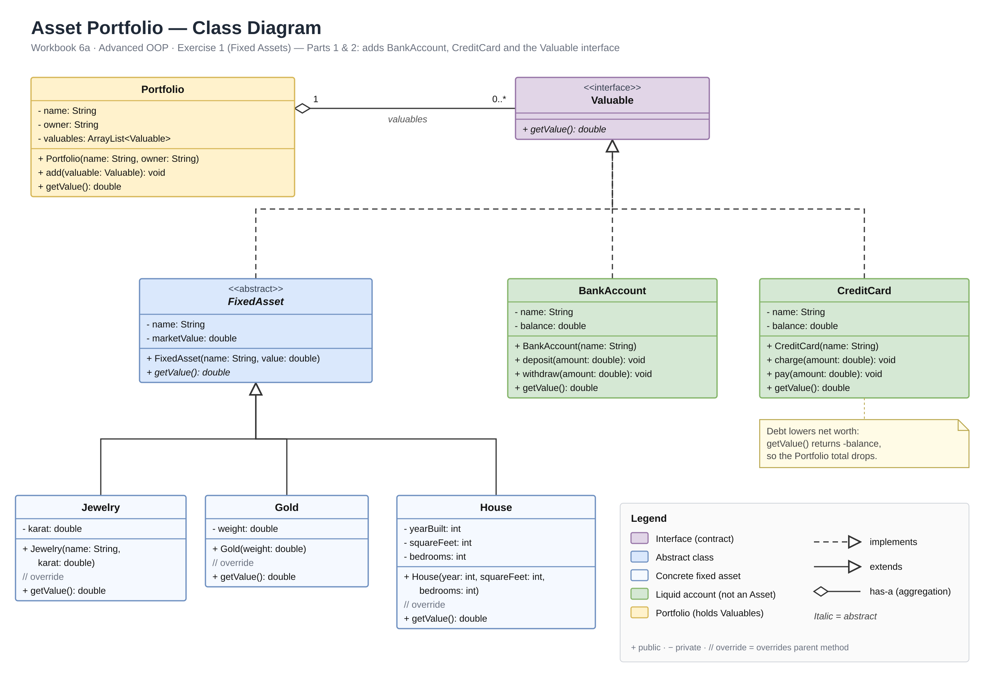

# Asset Portfolio – Class Diagram

**Workbook 6a – Advanced OOP · Exercise 1 (Fixed Assets)**

This project is a UML class diagram for an asset portfolio application. It shows how we extended a portfolio that only held fixed assets (jewelry, gold, houses) so it can also include liquid accounts (bank accounts) and debt (credit cards), giving a better estimate of real net worth.



A PDF version and the editable draw.io source are included in this repository.

## Project specs

**Starting point:** A `Portfolio` is made up of `FixedAsset` objects (`Jewelry`, `Gold`, `House`) and can calculate the total value of everything in it.

**Requirements for this change:**

- Add a `BankAccount` class with `deposit` and `withdraw` methods.
- Add a `CreditCard` class with `charge` and `pay` methods (debt).
- Fixed assets must **not** have `withdraw`, `deposit`, `charge` or `pay`.
- `BankAccount` and `CreditCard` must **not** extend the `Asset` class.
- Create a new interface named `Valuable` that defines `getValue()`.
- Update `Portfolio` so its list can hold the new classes.

## How the diagram is structured

| Class / Interface | Type | Role |
|---|---|---|
| `Valuable` | Interface | The contract: anything with a value must provide `getValue()` |
| `Portfolio` | Class | Holds an `ArrayList<Valuable>` and totals their values |
| `FixedAsset` | Abstract class | Shared `name` and `marketValue` for physical assets; implements `Valuable` |
| `Jewelry`, `Gold`, `House` | Classes | Extend `FixedAsset`; each overrides `getValue()` |
| `BankAccount` | Class | Implements `Valuable`; has `deposit` and `withdraw` |
| `CreditCard` | Class | Implements `Valuable`; has `charge` and `pay`; `getValue()` returns `-balance` |

Relationships used:

- **Implements** (dashed line, hollow triangle): `FixedAsset`, `BankAccount` and `CreditCard` → `Valuable`
- **Extends** (solid line, hollow triangle): `Jewelry`, `Gold` and `House` → `FixedAsset`
- **Aggregation / has-a** (hollow diamond): `Portfolio` holds 0 or more `Valuable` objects

## Why we designed it this way

**1. `Valuable` is an interface, not another parent class.**
`BankAccount` and `CreditCard` cannot extend `Asset`, and Java allows a class to extend only one parent. An interface lets unrelated classes share a contract without sharing an inheritance chain. A class can implement as many interfaces as it needs.

**2. `Portfolio` depends on `Valuable`, not on specific classes.**
`Portfolio` only needs to ask "what are you worth?" It does not need to know about `karat`, `withdraw` or `charge`. This is abstraction: expose only what is necessary. Because the list is `ArrayList<Valuable>`, we can add new kinds of valuables later without changing `Portfolio`.

**3. `FixedAsset` stays abstract and implements `Valuable`.**
`FixedAsset` holds what all physical assets share (`name`, `marketValue`) but cannot be created on its own. Since a parent that implements an interface passes it down to its children, `Jewelry`, `Gold` and `House` are all `Valuable` through `FixedAsset`. They do not need their own arrow to the interface. Each one still has to override `getValue()`.

**4. Liquid accounts are separate from fixed assets.**
Bank balances and credit card balances change often. Fixed asset values do not. Keeping `deposit`, `withdraw`, `charge` and `pay` out of `FixedAsset` stops physical assets from getting methods that make no sense for them.

**5. Debt counts as negative value.**
`CreditCard.getValue()` returns `-balance`. When the `Portfolio` adds up all the `getValue()` results, debt lowers the total automatically, with no special case in `Portfolio`.

**6. Colors and legend.**
Purple is the interface, blue is the abstract class and fixed assets, green is the liquid accounts, and yellow is `Portfolio`. This makes the "fixed vs. liquid" split visible at a glance.

## Corrections made to the original diagram

- Moved the aggregation diamond to the `Portfolio` end. In UML the diamond goes on the container, and the original had it on the `FixedAsset` end.
- Renamed the `Asset(...)` constructor to `FixedAsset(...)` so it matches the class name.
- `BankAccount` and `CreditCard` attributes (`name`, `balance`) are our own choice, since the workbook does not specify them.

## Concepts demonstrated

- Interfaces as contracts (`implements`)
- Abstract classes vs. interfaces
- Why Java has single inheritance but multiple interface implementation
- Abstraction and programming to an interface
- UML relationships: implementation, inheritance, aggregation
- How `implements`, `@Override` and compile-time contracts work in Java (see **What we learned**)

## What we learned (Q&A)

These are questions we asked while building this project, with the answers we worked out.

### 1. How do `BankAccount`, `CreditCard` and `FixedAsset` implement `Valuable`? Is it like `extends`?

It is similar, but not the same. With `extends`, a child inherits the parent's actual code. With `implements` on a plain interface, there is no code to inherit. The class only inherits a **requirement**: "I will have a `public double getValue()`." Each class then writes its own body.

```java
public interface Valuable {
    double getValue();          // no body; implicitly public abstract
}

public abstract class FixedAsset implements Valuable {
    private String name;
    private double marketValue;

    public FixedAsset(String name, double marketValue) {
        this.name = name;
        this.marketValue = marketValue;
    }
    // No getValue() here. That is allowed because the class is abstract.
}

public class BankAccount implements Valuable {
    private String name;
    private double balance;

    public BankAccount(String name) { this.name = name; }

    public void deposit(double amount)  { balance += amount; }
    public void withdraw(double amount) { balance -= amount; }

    @Override
    public double getValue() { return balance; }
}

public class CreditCard implements Valuable {
    private String name;
    private double balance;   // amount owed

    public CreditCard(String name) { this.name = name; }

    public void charge(double amount) { balance += amount; }
    public void pay(double amount)    { balance -= amount; }

    @Override
    public double getValue() { return -balance; }   // debt lowers net worth
}
```

`Jewelry`, `Gold` and `House` extend `FixedAsset`, so they get the requirement through their parent. Because `FixedAsset` is abstract it may skip `getValue()`, but the first **concrete** class below it must write it.

### 2. Do we need `@Override`?

It is not required, but it is strongly recommended. `@Override` tells the compiler "this must match a method in a parent or interface." If we typo `getvalue()` or write `int getValue()`, we get a clear compile error right away. Without it, Java treats the method as a brand-new one, and the confusing error shows up somewhere else.

Also, the method must be `public` in the implementing class, because interface methods are public.

### 3. What if `Gold` or `BankAccount` did not have `getValue()`? Would it compile?

No. It is a compile error:

```
BankAccount is not abstract and does not override abstract method getValue() in Valuable
```

The class signed the contract, so a concrete class must deliver every method in it. `Gold` gets the same error through `FixedAsset`. The only ways around it are to write the method, or to mark the class `abstract` (which means it can never be created with `new`, and the next concrete class down must provide the method). A method with the wrong signature, such as `int getValue()` or `getValue(int x)`, does not count either.

### 4. Why use an interface instead of copying `getValue()` into each class?

The problem is not the method, it is the shared **type**. `Portfolio` needs one list that can hold everything:

```java
public class Portfolio {
    private ArrayList<Valuable> valuables = new ArrayList<>();

    public void add(Valuable v) { valuables.add(v); }

    public double getValue() {
        double total = 0;
        for (Valuable v : valuables) {
            total += v.getValue();   // works for ANY Valuable
        }
        return total;
    }
}
```

Without a shared interface:

- `BankAccount` cannot go in a list of `Asset`, because the project says it must not extend `Asset`.
- The only common type left is `Object`, which has no `getValue()`, so `v.getValue()` would not compile.
- We would need `instanceof` checks for every class and a new branch each time we add one.

The interface gives the compiler a guarantee: anything in the list has `getValue()`. Adding a `Stock` class later only needs `implements Valuable`, and `Portfolio` does not change.

We could have made `Valuable` an abstract class instead, but then every class would use up its one `extends` slot. A class can implement many interfaces, and `Valuable` has no shared state, which suits an interface.

### 5. Why is this considered good practice? What are other use cases, and how does it relate to system design?

"Program to an interface, not an implementation" is a widely accepted design principle. It gives us:

1. **Loose coupling:** code that uses `Valuable` does not depend on `House` or `BankAccount`.
2. **Extensibility:** add new classes without editing working code (the "open for extension, closed for modification" idea).
3. **Compiler-checked contracts:** the compiler guarantees the method exists.

Other use cases:

- **Java's own libraries:** `List<String> names = new ArrayList<>();` can later become a `LinkedList` by changing one word.
- **`Comparable` / `Comparator`:** sorting works on any class that promises a `compareTo` method.
- **Swappable behavior:** for example `TaxCalculator` with different implementations per country.
- **Testing:** use a real data feed in production and a fake one in tests, behind the same interface.
- **Multiple roles:** a class can extend one parent but implement many interfaces.

In larger system design the same idea appears as boundaries between layers and services. A service layer can depend on a `Repository` interface instead of a specific database. An API between two services is a contract that says what is available and nothing about how it is built. Teams can agree on the interface first and build both sides in parallel, and wrapping a vendor (payments, an AI model) behind our own interface makes switching vendors a contained change.

**Caveat:** this is a guideline, not a law. An interface for a class that will only ever have one implementation, with no tests swapping it out, adds indirection for little benefit. A good rule of thumb is to add an interface when we can name a second implementation, or when another part of the system needs a stable boundary. Our exercise qualifies, because three unrelated classes must live in one list.

## Tools

Diagram made with [draw.io](https://www.drawio.com) (free).
